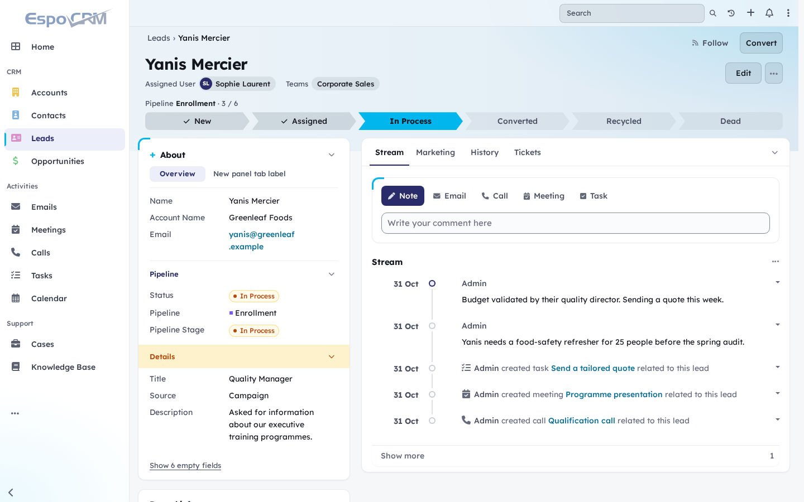
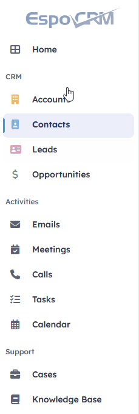
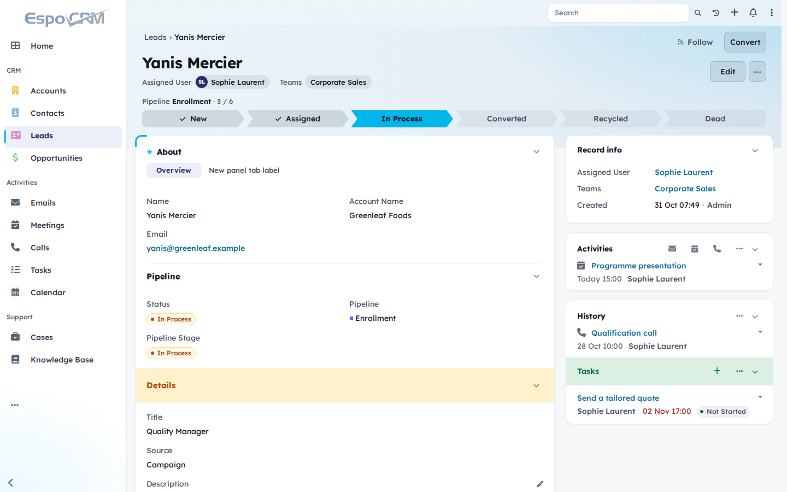
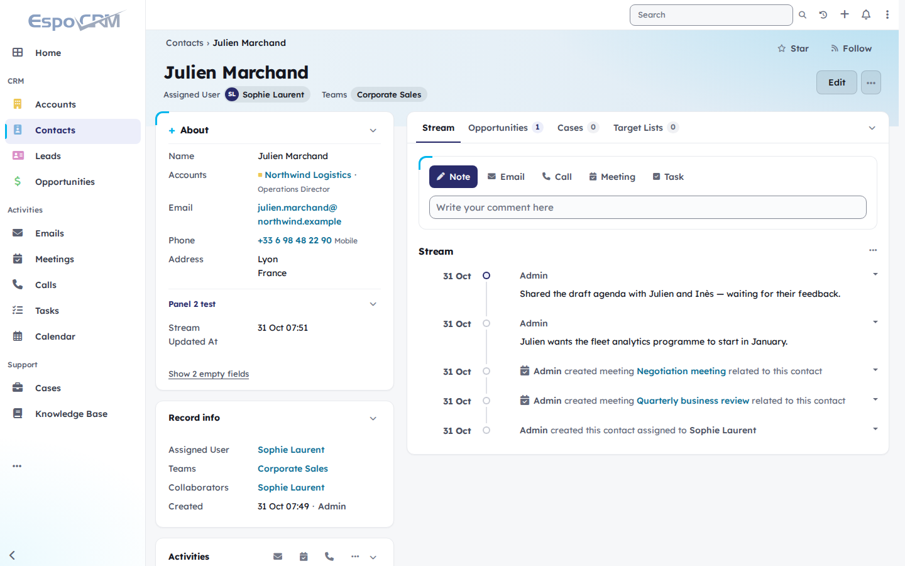
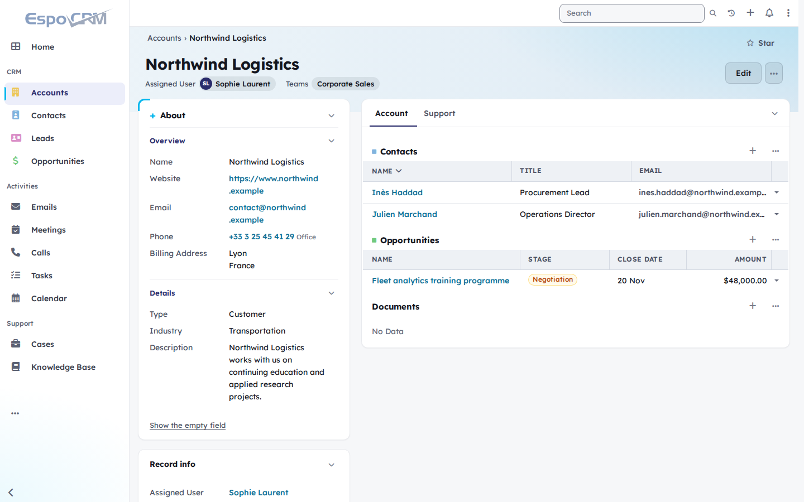
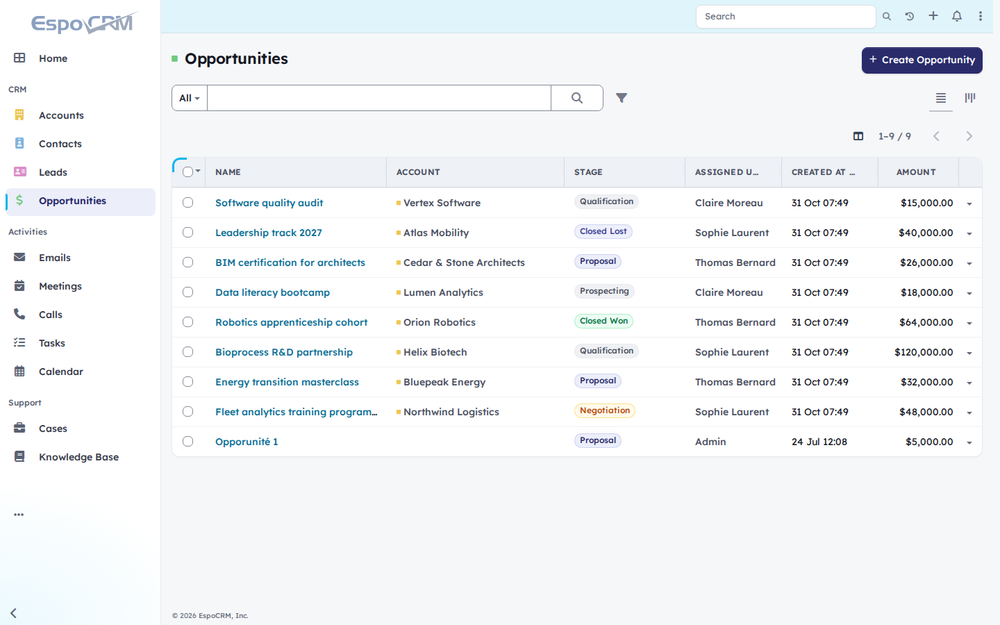
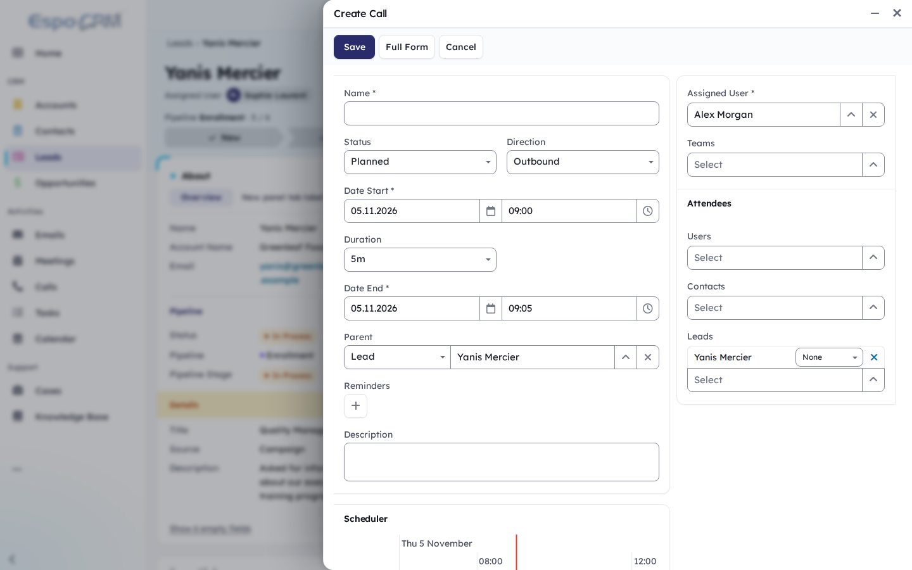

# Lucid — a theme for EspoCRM

Lucid is a light, readable theme for [EspoCRM](https://www.espocrm.com/) with a modern SaaS feel.
It reworks the record view — fields on one side, activity on the other, or the classic EspoCRM
arrangement, your choice — adds a band with the record's owner and pipeline stages, and makes every
block collapsible.
It uses a deep indigo (`#292B6B`) for actions and cyan (`#00B6ED`) as the signature accent, comes
with a dark palette that can follow the operating system, and targets WCAG 2.1 AA / RGAA.



## In motion


Quick actions open EspoCRM's own side panel, every block folds like an accordion, and a click on a
stage moves the record along its pipeline.

| | |
|---|---|
|  |  |
| Drag the handle between the columns to widen About; fold the sections you don't need | Empty fields stay out of the way until you ask for them |



A click on a title of the side menu folds its group; the page you are on stays visible.

## Two layouts, one extension

Installing the extension adds two entries to the theme list. They share the same design and features;
only the arrangement of the record view changes.

| **Lucid Classic** | **Lucid Split** |
|---|---|
|  |  |
| Fields and bottom panels on the left, side panels on the right, as in stock EspoCRM | Fields on the left, bottom panels on the right: the activity is visible as soon as the record opens |

The administrator sets the default in **Administration > User Interface**, and each user can pick
another one in **Preferences**.

## Screenshots

| | |
|---|---|
|  |  |
| Contact: About card, Record info card, quick actions and stream | Account: layout panels on the left, relationship tabs on the right |
|  |  |
| List as a card, marked column headers, coloured record links, stage badges | Native EspoCRM side panel, detached from the page |

All data in the screenshots is fictitious.

## Features

- **Side-by-side record view** (Lucid Split). The **About** card on the left holds the layout panels as a
  compact property list (tab breaks become tabs, styled like those of the main column), followed by a **Record info** card
  (assigned user, teams, dates, followers) and the side panels (Activities, History, Tasks…). The
  right column starts with the **Stream** tab — quick actions (Note, Email, Call, Meeting, Task)
  above the stream as a timeline — then one tab per bottom panel, with its count. Which panels show
  where is left to the layouts set in the Entity Manager: side panels on the left, bottom panels on
  the right, exactly as configured.
- **Band** at the top of each record: name, assigned users and teams, record actions and, for
  entities with an active pipeline, the stage path (click a stage to move the record if you may
  edit it). On narrow screens the path folds into the current stage and a progress bar; tap it to
  see every stage.
- **Collapsible blocks.** About, Record info, the side panels, each layout panel and the bottom
  panels block fold like an accordion. The state is remembered per user and record type; everything
  opens while editing.
- **Collapsible menu groups.** A click on a title of the side menu (CRM, Activities…) folds the items
  below it, up to the next title. The page in progress stays visible, the state is remembered per
  user, and an icons-only menu keeps every item.
- **Adjustable column.** A handle between the columns sets the width of the narrow column, from 300
  to 720 px (mouse, or arrow keys / Home / End; double-click to reset), remembered per user and per
  layout. The main column keeps at least 480 px.
- **Empty fields hidden** behind a "Show N empty fields" link, all shown while editing.
- **Readability.** One typeface, Lexend, for text and titles; labels as large as values; record
  links coloured so that what is clickable stands out; comfortable form fields.
- **Light palette.** White sidebar, ice-blue top bar and record band, cards with a cyan corner mark.
  Colours are CSS tokens (`--lucid-band-*`, `--lucid-sidebar-*`, `--lucid-table-*`), easy to retune.
- **Dark palette.** A button in the top bar (next to the notifications; in the menu on a phone)
  offers Light, Dark and System, which follows the operating system, even when it switches at
  nightfall. The change is immediate and saved in the user's preferences; pages then open directly
  in the chosen palette. Light is the default. The dark palette tints its surfaces towards the
  indigo and uses periwinkle for actions. E-mail bodies, code editors, charts and the calendar turn
  dark as with EspoCRM's own Dark theme, and e-mails that bring their own colours stay on a light
  background. The button is hidden when the administrator has disabled the choice of theme.
- **Marked table columns.** Tinted uppercase headers with vertical lines, a cyan tint when hovering a
  column, and a clearer row hover, in lists and in the tables of a record.
- **Quiet loading indicator.** EspoCRM's spinner becomes a small white pill with a turning cyan ring
  in the top bar, and only shows when a wait is long enough to notice.
- **Speaks every EspoCRM language.** Labels come from EspoCRM's own translations; only the
  empty-fields link and the Record info title are the theme's own, translated into every language
  EspoCRM ships.

Knowledge base articles (and any entity with a rich-text `body`) keep their fields in the main
column, full width. Email and User records, and detail views opened in dialogs, keep the EspoCRM
layout. Panel actions, inline editing and access rights are EspoCRM's own. Panel colours chosen in
the layouts (Danger, Warning, Success, Info, Primary) show as in EspoCRM: a tinted band across the
block with the title in colour, in the About card, the side cards and the main column alike.

## Accessibility

- Text contrast of at least 4.5:1 and form field borders of at least 3:1, checked for every colour
  of both palettes;
  titles and action icons on coloured panel headings (Danger, Warning…) are darkened to stay above
  4.5:1 on their tint.
- Visible keyboard focus, including on dark areas; reduced motion when the system asks for it.
- The record name is the page heading; pipeline steps wrap instead of being cut when zoomed.
- The page declares its language and allows zooming on mobile (EspoCRM does neither by default).
- Custom controls (tabs, accordions, column handle) expose their state to screen readers.

Some remaining issues come from EspoCRM's own markup (icon-only buttons, unlabeled list
checkboxes) and are outside the scope of a theme.

## Install

Requires EspoCRM 10.0 or later and PHP 8.3+ (tested on 10.0.3, 10.0.11 and 10.1.0).

1. Download `lucid-theme-<version>.zip` from the
   [latest release](https://github.com/AlexisSantin/espocrm-lucid-theme/releases/latest).
2. In EspoCRM: **Administration > Extensions > Upload**, choose the ZIP, then **Install**.
3. Select **Lucid Classic** or **Lucid Split** in **Administration > User Interface > Theme** (default for
   everyone, also used on the login page) or per user in **Preferences**.

Updates install the same way, over the previous version.

## Development

```bash
cd lucid-theme
npm install
npm run sync          # copy src/files into ../site
npm run clear-cache   # after metadata or translation changes
npm run extension     # build build/lucid-theme-<version>.zip
```

- The CSS files imported by `lucid.css` and `lucid-iframe.css` carry `?v=<version>`: bump it
  together with `package.json` on every release so browsers drop stale copies.
- The module is bundled: in production EspoCRM loads `lib/module-lucid-theme.js` through
  `lib/init.js`, listed in `app/client.json` `scriptList`. Developer mode loads the transpiled
  sources instead, so test a release on an instance with developer mode off.
- The themes `LucidClassic` and `Lucid` (displayed as Lucid Split) load the same stylesheet; the handler
  picks the record template from the theme name (`isClassicLayout` in `src/lucid.js`).
- The record view is applied by a `record/detail` view setup handler that derives the bottom view
  configured for the entity instead of replacing it. If it cannot apply (an unexpected EspoCRM
  version, for instance), the record keeps the EspoCRM layout. Apart from the top bar button, an
  EspoCRM view, the module imports no EspoCRM client module, and it never uses admin-only
  translation scopes (they are not sent to regular users).
- The dark palette (`css/lucid-dark.css`) redefines the tokens on `:root[data-lucid-scheme="dark"]`.
  `js/color-scheme.js`, a plain script listed before the stylesheet, sets that attribute from the
  choice remembered by the browser, so a page never flashes the light palette; the top bar button
  stores the choice in the `lucidColorScheme` preference. EspoCRM reads `isDark`, the e-mail
  stylesheets and the chart and calendar colours from theme parameters: while the dark palette is
  on, the theme manager returns the values of the theme's `lucidDark` block instead
  (`src/helpers/color-scheme.js`). If that cannot apply, those elements keep their light look.

```
src/files/custom/Espo/Modules/LucidTheme/Resources/
    metadata/themes/                    LucidClassic and Lucid (Lucid Split): parameters, chart and calendar colours,
                                        their dark values (lucidDark)
    metadata/app/client.json            js/color-scheme.js, lib/init.js (bundle loader in production)
    metadata/app/clientNavbar.json      top bar button (Light, Dark, System)
    metadata/entityDefs/Preferences.json  the lucidColorScheme preference
    metadata/clientDefs/Global.json     view setup handlers
    i18n/en_US, i18n/fr_FR              the theme's own labels
src/files/client/custom/modules/lucid-theme/
    css/lucid.css                       entry point (imports the stock light theme, then the layers)
    css/lucid-tokens.css                colours, radii, shadows, band and sidebar tokens
    css/lucid-espo-vars.css             EspoCRM variables mapped to the tokens
    css/lucid-*.css                     base, shell, controls, data, record, detail, overlays, login
    css/lucid-dark.css                  dark palette
    css/lucid-iframe-dark.css           e-mail bodies in the dark palette
    res/templates/record/detail*.tpl    record view templates
    src/handlers/record-detail.js       applies the record view
    src/handlers/page-a11y.js           document language and zoom
    src/helpers/record-band.js          band: identity, people, pipeline stage path
    src/helpers/panel-collapse.js       collapsible blocks
    src/helpers/column-resizer.js       width handle for About
    src/helpers/empty-fields.js         hides empty fields
    js/nav-groups.js                    collapsible groups of the side menu (plain script)
    js/color-scheme.js                  applies the palette before the page shows (plain script)
    src/views/navbar/color-scheme.js    top bar button: Light, Dark, System
    src/helpers/color-scheme.js         EspoCRM's dark parameters while the dark palette is on
    src/mixins/detail-bottom.js         right column: tabs, quick actions, counts
    fonts/                              Lexend (OFL)
```

## License

GPL-3.0-or-later. The bundled Lexend typeface is licensed under the SIL Open Font License 1.1
(`fonts/Lexend-OFL.txt`).
